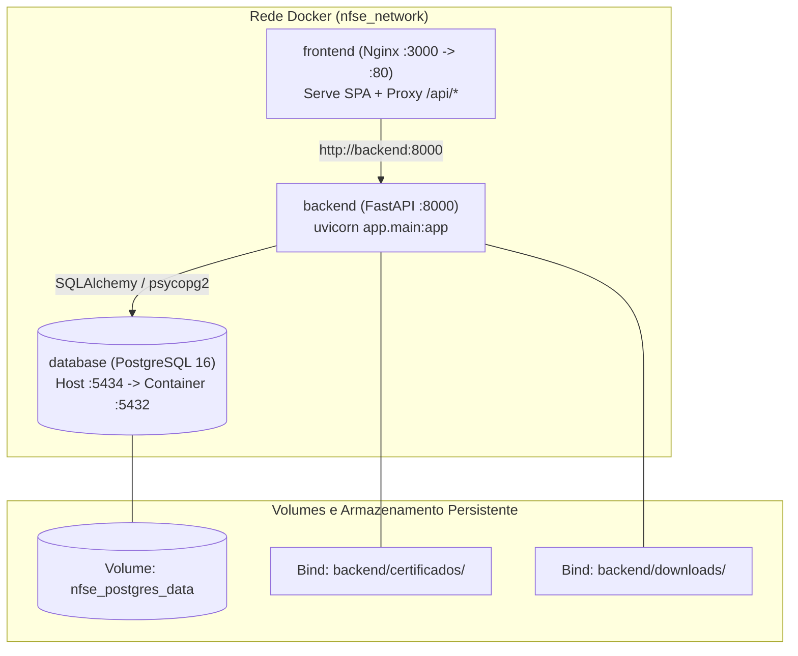
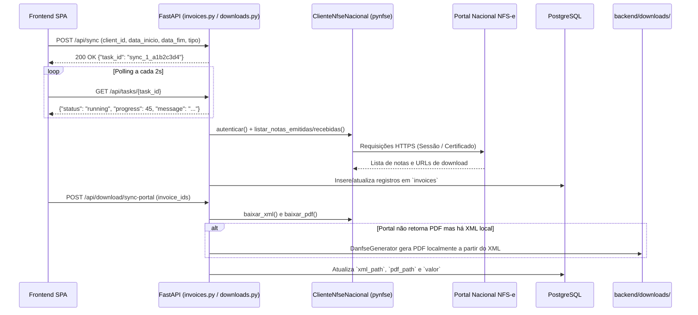

# NFSe Manager Pro — Documentação Técnica de Arquitetura e Uso

Este documento descreve em detalhes a arquitetura interna, a modelagem de dados no PostgreSQL, o funcionamento dos containers Docker, os fluxos operacionais (sincronização com portal, emissão ADN v1.01, cálculo tributário IBS/CBS e atualização transacional) e os contratos de API do **NFSe Manager Pro**.

---

## 1. Visão Geral da Arquitetura

O sistema é dividido em quatro módulos desacoplados no mesmo repositório:

1. **`database/` (Persistência Relacional)**: serviço **PostgreSQL 16 Alpine** responsável por armazenar o cadastro de clientes, credenciais, parâmetros fiscais e histórico de notas fiscais (`clients` e `invoices`).
2. **`backend/` (API & Motor Fiscal)**: aplicação **FastAPI** estruturada no pacote Python `app` (`backend/app/`), responsável pelas regras de negócio, integração com o robô de captura do portal nacional (`ClienteNfseNacional`), orquestração de emissão e eventos no ADN (`AdnService` / `pynfse.adn`), geração local de DANFSE em PDF e gerenciamento de arquivos em `backend/certificados/` e `backend/downloads/`.
3. **`frontend/` (Interface Web SPA)**: aplicação single-page em HTML5, CSS3 modular e JavaScript ES6 Vanilla, que pode ser servida diretamente pelo FastAPI (em desenvolvimento/desktop) ou por um container dedicado **Nginx Alpine** (em produção via Docker, atuando também como reverse proxy para `/api/*`).
4. **`ui/` (Shell Desktop Nativo)**: aplicação **Tauri (Rust)** que empacota a interface e o servidor Python (como binário sidecar via PyInstaller) em um executável nativo para Linux, Windows e macOS.



---

## 2. Organização Interna do Backend (`backend/app`)

O diretório `backend/` é a raiz de execução Python (`PYTHONPATH=backend` / `--app-dir backend`), e todo o código-fonte reside no pacote `app`:

| Caminho | Responsabilidade |
| :--- | :--- |
| `backend/app/main.py` | Inicializa o FastAPI, configura CORS, chama `init_db()`, expõe `/api/health`, registra os 9 routers e monta o `frontend/` estático quando presente. |
| `backend/app/database.py` | Configura a `engine` SQLAlchemy (`pool_pre_ping=True`) conectada ao PostgreSQL via `DATABASE_URL` e fornece a dependência `get_db()`. |
| `backend/app/models.py` | Declara os modelos ORM `Client` e `Invoice` e a função `init_db()` com retry automático de conexão e inspeção de colunas via `sqlalchemy.inspect`. |
| `backend/app/schemas.py` | Define todos os schemas Pydantic para validação de payloads e serialização de respostas. |
| `backend/app/version.py` | Lê a versão oficial diretamente do `pyproject.toml` na raiz do repositório (`VERSION`). |
| `backend/app/services/adn_service.py` | Fachada unificada que integra o banco PostgreSQL e o armazenamento em `backend/downloads/adn/` ao pacote `pynfse.adn`. |
| `backend/app/api/deps.py` | Constrói instâncias do `ClienteNfseNacional` configurando `save_path` padrão em `backend/downloads/` e resolvendo certificados em `backend/certificados/`. |
| `backend/app/api/state.py` | Mantém o dicionário em memória `tasks_status` para acompanhamento assíncrono de tarefas em background. |

---

## 3. Modelagem do Banco de Dados (PostgreSQL)

```mermaid
erDiagram
    CLIENTS ||--o{ INVOICES : "possui (client_id)"

    CLIENTS {
        int id PK
        varchar cnpj UK
        varchar razao_social
        varchar username
        varchar password
        varchar cert_path
        varchar cert_password
        varchar description
        varchar save_path
        varchar path_structure
        varchar inscricao_municipal
        varchar codigo_municipio
        varchar uf
        varchar cep
        varchar logradouro
        varchar numero
        varchar complemento
        varchar bairro
        varchar telefone
        varchar email
        varchar regime_tributario
        varchar regime_apuracao_sn
        varchar regime_especial
        varchar serie_dps_padrao
        int ultimo_numero_dps
        varchar ambiente_padrao
    }

    INVOICES {
        int id PK
        int client_id FK
        timestamp data_emissao
        varchar numero
        varchar chave UK
        varchar status
        varchar tipo
        double valor
        varchar xml_path
        varchar pdf_path
        varchar download_url_xml
        varchar download_url_pdf
        varchar id_dps
        varchar serie_dps
        int numero_dps
        varchar chave_substituida
        varchar chave_substituta
        varchar motivo_cancelamento
        timestamp data_cancelamento
        varchar xml_dps_path
        varchar xml_evento_path
        double valor_iss
        double valor_ibs
        double valor_cbs
        double valor_liquido
        varchar c_trib_nac
        varchar c_nbs
        varchar c_class_trib
        varchar cst_ibscbs
    }
```



---

## 4. Fluxos Operacionais Detalhados

### 4.1. Sincronização e Download de Notas do Portal



### 4.2. Emissão de DPS, Substituição e Cancelamento via ADN (v1.01)

```mermaid
sequenceDiagram
    participant UI as Cliente API / Frontend
    participant Router as emission.py
    participant Svc as AdnService
    participant PyNfse as pynfse.adn
    participantADN as Sefin Nacional / ADN (mTLS)
    participant DB as PostgreSQL

    UI->>Router: POST /api/adn/dps/emitir (EmitirDpsRequest)
    Router->>Svc: emitir_dps(db, req)
    Svc->>DB: Carrega dados fiscais e certificado A1 do Client
    Svc->>PyNfse: calcular_tributacao() + build_dps_xml()
    Svc->>PyNfse: XsdValidator.validar_dps(xml_bruto)
    Svc->>PyNfse: DpsSigner.sign_xml(xml_bruto, tag_to_sign="infDPS")
    Svc->>PyNfse: XsdValidator.validar_dps(xml_assinado)
    Svc->>Svc: Salva XML em backend/downloads/adn/dps/{id_dps}.xml
    alt transmitir == True e assinado com certificado
        Svc->>participantADN: POST mTLS (AdnNfseClient.emitir_dps)
        participantADN-->>Svc: Status 201 + chave_acesso (50 dígitos) + nfse_xml
    end
    Svc->>DB: Persiste Invoice e incrementa Client.ultimo_numero_dps
    Svc-->>UI: JSON completo (id_dps, chave_acesso, validacao_xsd, tributacao, xml_assinado)
```

### 4.3. Regras da Calculadora Tributária (NT 1.101 / LC 214/2025)

O motor tributário acionado em `POST /api/tax/calculate` (e automaticamente durante a emissão da DPS) respeita o cronograma de transição da Reforma Tributária:

- **Ano de competência 2026**:
  - Calcula `ISSQN` e retenções federais (`PIS`, `COFINS`, `IRRF`, `CSLL`, `INSS`).
  - A base de cálculo `vBC` do `IBS/CBS` deduz o `ISSQN` e o `PIS/COFINS`:
    $$\text{vBC}_{\text{IBS/CBS}} = \text{vServ} - \text{Desconto Incond.} - \text{Reembolso} - \text{Deduções} - \text{ISS} - \text{PIS} - \text{COFINS}$$
  - O `IBS` e a `CBS` têm caráter informativo/teste e não somam por fora no `valor_total_nf`.
- **Anos de competência 2027 a 2032**:
  - `PIS` e `COFINS` são extintos (substituídos pela `CBS`).
  - O `ISSQN` permanece sendo deduzido da `vBC` do `IBS/CBS`.
  - O valor líquido de `IBS + CBS` passa a compor o valor total da nota (`valor_total_nf`).
- **Ano de competência 2033 em diante**:
  - O `ISSQN` também é extinto (substituído integralmente pelo `IBS`), não sendo mais deduzido da `vBC`.
- **Reduções e Regimes Especiais suportados**:
  - Reduções automáticas por `cClassTrib` (ex.: `200029` Saúde com 60% de redução; `200025` Prouni com 60% IBS e 100% CBS; `200052` Profissão Regulamentada com 30%; `200027` Locação de bens imóveis com 70%).
  - Diferimento (`pDifUF`, `pDifMun`, `pDifCBS`), Crédito Presumido (`cCredPres`), Tributação Regular (`CSTReg` / `cClassTribReg`) e Compras Governamentais (`tpEnteGov` / `pRedutorGov`).

---

## 5. Orquestração com Docker e Docker Compose

O projeto conta com três configurações independentes e um orquestrador na raiz:

1. **`database/docker-compose.yml`**:
   - Sobe o container `nfse_database` (`postgres:16-alpine`).
   - Mapeia a porta `${POSTGRES_PORT:-5434}:5432` e persiste os dados no volume `nfse_postgres_data`.
2. **`backend/docker-compose.yml`**:
   - Constrói a imagem usando `backend/Dockerfile` (com contexto na raiz `..` para ler `pyproject.toml` e `poetry.lock`).
   - Monta `backend/certificados` e `backend/downloads` como volumes persistentes.
   - Conecta ao serviço `database:5432` pela rede `nfse_network`.
3. **`frontend/docker-compose.yml`**:
   - Constrói a imagem `nginx:1.27-alpine` com `frontend/Dockerfile` e `frontend/nginx.conf`.
   - Expõe a interface na porta `3000` e encaminha chamadas `/api/*`, `/docs`, `/redoc` e `/openapi.json` para `http://backend:8000`.
4. **`docker-compose.yml` (Raiz)**:
   - Usa `include` do Docker Compose v2+ para unir `database/docker-compose.yml`, `backend/docker-compose.yml` e `frontend/docker-compose.yml`.

---

## 6. Guia para Adicionar Novos Routers

Para estender a API com um novo domínio:

1. Crie o módulo em `backend/app/api/routers/meu_dominio.py`:
   ```python
   from fastapi import APIRouter, Depends
   from sqlalchemy.orm import Session
   from app.database import get_db

   router = APIRouter(prefix="/api/meu-dominio", tags=["meu_dominio"])

   @router.get("")
   def listar_itens(db: Session = Depends(get_db)):
       return {"status": "ok"}
   ```
2. Registre o router em [`backend/app/main.py`](file:///home/cleiton/PyJobs/MeusProjetos/nfse_manager/backend/app/main.py):
   ```python
   from app.api.routers import meu_dominio
   app.include_router(meu_dominio.router)
   ```
3. Adicione os testes correspondentes na pasta `tests/` e execute `poetry run pytest -v` e `poetry run ruff check backend tests`.
