# 🗄️ Banco de Dados (PostgreSQL)

O **NFSe Manager Pro** utiliza **PostgreSQL 16** gerenciado pelo **SQLAlchemy 2.0** (`backend/app/database.py` e `backend/app/models.py`).

---

## 1. Configuração de Conexão (`backend/app/database.py`)

A conexão é resolvida através da variável `DATABASE_URL` ou montada a partir das variáveis individuais `POSTGRES_*`:

```python
POSTGRES_USER = os.getenv("POSTGRES_USER", "nfse_user")
POSTGRES_PASSWORD = os.getenv("POSTGRES_PASSWORD", "nfse_pass")
POSTGRES_HOST = os.getenv("POSTGRES_HOST", "localhost")
POSTGRES_PORT = os.getenv("POSTGRES_PORT", "5434")
POSTGRES_DB = os.getenv("POSTGRES_DB", "nfse_db")
```

Na inicialização da aplicação (`init_db()` em `backend/app/models.py`), o sistema:

1. Aguarda o banco ficar disponível com *retry* automático (até 10 tentativas).
2. Executa `Base.metadata.create_all(bind=engine)` para criar as tabelas caso não existam.
3. Inspeciona as colunas existentes via `sqlalchemy.inspect(engine)` e aplica `ALTER TABLE ... ADD COLUMN` automaticamente para manter compatibilidade evolutiva.

---

## 2. Diagrama Entidade-Relacionamento (ERD)

```mermaid
erDiagram
    CLIENTS ||--o{ INVOICES : "client_id"

    CLIENTS {
        int id PK
        varchar cnpj UK
        varchar razao_social
        varchar username
        varchar password
        varchar cert_path
        varchar cert_password
        varchar description
        varchar save_path
        varchar path_structure
        varchar inscricao_municipal
        varchar codigo_municipio
        varchar uf
        varchar cep
        varchar logradouro
        varchar numero
        varchar complemento
        varchar bairro
        varchar telefone
        varchar email
        varchar regime_tributario
        varchar regime_apuracao_sn
        varchar regime_especial
        varchar serie_dps_padrao
        int ultimo_numero_dps
        varchar ambiente_padrao
    }

    INVOICES {
        int id PK
        int client_id FK
        timestamp data_emissao
        varchar numero
        varchar chave UK
        varchar status
        varchar tipo
        double valor
        varchar xml_path
        varchar pdf_path
        varchar download_url_xml
        varchar download_url_pdf
        varchar id_dps
        varchar serie_dps
        int numero_dps
        varchar chave_substituida
        varchar chave_substituta
        varchar motivo_cancelamento
        timestamp data_cancelamento
        varchar xml_dps_path
        varchar xml_evento_path
        double valor_iss
        double valor_ibs
        double valor_cbs
        double valor_liquido
        varchar c_trib_nac
        varchar c_nbs
        varchar c_class_trib
        varchar cst_ibscbs
    }
```



---

## 3. Dicionário de Dados

### Tabela `clients`

| Coluna | Tipo | Padrão | Descrição |
| :--- | :--- | :--- | :--- |
| `id` | `INTEGER` | PK Auto | Identificador interno do cliente |
| `cnpj` | `VARCHAR` | Único | CNPJ ou CPF do prestador/tomador |
| `razao_social` | `VARCHAR` | — | Nome empresarial / Razão Social |
| `username` / `password` | `VARCHAR` | — | Credenciais de acesso ao portal (`password` utiliza `EncryptedString` com AES/Fernet) |
| `cert_path` | `VARCHAR` | `NULL` | Caminho do certificado `.pfx` em `backend/certificados/{CNPJ}/` |
| `cert_password` | `VARCHAR` | `NULL` | Senha do certificado digital A1 (`EncryptedString` com AES/Fernet) |
| `save_path` | `VARCHAR` | `NULL` | Diretório base customizado (padrão: `backend/downloads/`) |
| `path_structure` | `VARCHAR` | `NULL` | Máscara de subpastas (ex.: `{CLIENTE}/{TIPO}/{ANO}/{MES}`) |
| `inscricao_municipal` | `VARCHAR` | `NULL` | Inscrição Municipal do prestador |
| `codigo_municipio` | `VARCHAR` | `"3201308"` | Código IBGE de 7 dígitos do município do prestador |
| `uf` | `VARCHAR` | `"ES"` | Sigla da UF do prestador |
| `regime_tributario` | `VARCHAR` | `"normal"` | `normal`, `simples` ou `mei` |
| `regime_apuracao_sn` | `VARCHAR` | `"1"` | Regime de apuração de tributos pelo Simples Nacional (`regApTribSN`) |
| `regime_especial` | `VARCHAR` | `"0"` | Regime especial de tributação (`regEspTrib`) |
| `serie_dps_padrao` | `VARCHAR` | `"900"` | Série padrão para emissão de DPS |
| `ultimo_numero_dps` | `INTEGER` | `0` | Último número sequencial de DPS emitido pelo cliente |
| `ambiente_padrao` | `VARCHAR` | `"homologacao"` | Ambiente padrão ADN (`homologacao` ou `producao`) |

### Tabela `invoices`

| Coluna | Tipo | Descrição |
| :--- | :--- | :--- |
| `id` | `INTEGER` (PK) | Identificador interno da nota fiscal |
| `client_id` | `INTEGER` (FK) | Referência para `clients.id` |
| `data_emissao` | `TIMESTAMP` | Data/hora de emissão da nota |
| `numero` | `VARCHAR` | Número da NFS-e ou DPS |
| `chave` | `VARCHAR` (Único) | Chave de acesso de 50 dígitos da NFS-e |
| `status` | `VARCHAR` | Status (`gerada`, `dps_gerada`, `cancelada`, `substituida`, etc.) |
| `tipo` | `VARCHAR` | `emitidas` ou `recebidas` |
| `valor` | `DOUBLE PRECISION` | Valor bruto do serviço (`vServ`) |
| `xml_path` / `pdf_path` | `VARCHAR` | Caminho local do XML e do PDF (DANFSE) em `backend/downloads/` |
| `id_dps` | `VARCHAR` | Identificador de 45 caracteres da DPS (`DPS` + 42 dígitos) |
| `serie_dps` / `numero_dps` | `VARCHAR` / `INTEGER` | Série e número da DPS |
| `chave_substituida` / `chave_substituta` | `VARCHAR` | Chaves de 50 dígitos vinculadas em caso de substituição |
| `motivo_cancelamento` / `data_cancelamento` | `VARCHAR` / `TIMESTAMP` | Histórico de evento de cancelamento ou substituição |
| `xml_dps_path` / `xml_evento_path` | `VARCHAR` | Caminhos dos XMLs assinados de DPS e de eventos (`e101101` / `e105102`) |
| `valor_iss` / `valor_ibs` / `valor_cbs` / `valor_liquido` | `DOUBLE PRECISION` | Valores calculados de ISSQN, IBS, CBS e valor líquido da nota |
| `c_trib_nac` / `c_nbs` / `c_class_trib` / `cst_ibscbs` | `VARCHAR` | Classificações fiscais aplicadas na emissão |

---

## 4. Segurança e Criptografia em Repouso (Encryption at Rest)

Para autenticar no Portal Nacional da NFS-e e assinar lotes/eventos via mTLS com certificados A1 (`.pfx`), a aplicação necessita das senhas originais dos clientes (`password` e `cert_password`) em tempo de execução. Logo, **não é viável utilizar funções hash unidirecionais** (como BCrypt ou Argon2), pois elas impossibilitariam o envio das senhas reais aos serviços externos.

Para proteger os dados em caso de vazamento acidental do banco de dados ou despejos (`pg_dump`), o sistema adota **Criptografia Simétrica Autenticada em Repouso** via `backend/app/core/security.py`:

- **Algoritmo**: Fernet (AES-128 em modo CBC com HMAC-SHA256 para autenticação e integridade de dados).
- **Chave Mestra**: Definida na variável de ambiente `NFSE_ENCRYPTION_KEY` (com derivação determinística de 32 bytes via SHA-256).
- **Transparência ORM**: Implementado através do `EncryptedString(TypeDecorator)` em `backend/app/models.py`. As senhas são criptografadas antes do `INSERT`/`UPDATE` e decifradas na leitura pelo SQLAlchemy, mantendo o restante do código desacoplado.
- **Formato no Banco**: As strings criptografadas recebem o prefixo `enc:` seguido do payload Base64 seguro do Fernet (ex: `enc:gAAAAABn...`).
- **Migração Automática**: Na inicialização (`init_db()`), o sistema verifica se há credenciais legadas armazenadas em texto plano e as criptografa automaticamente de forma idempotente.

