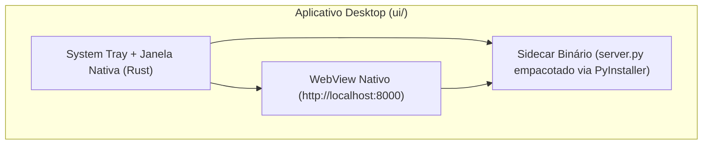

# 🖥️ Aplicativo Desktop Nativo (Tauri)

O diretório `ui/` contém o shell **Tauri (Rust)** que transforma o **NFSe Manager Pro** em um aplicativo desktop nativo para **Linux (`.deb`, `.AppImage`)**, **Windows (`.msi`, `.exe`)** e **macOS (`.dmg`)**.

---

## 1. Como Funciona



- **Sem duplicação de frontend**: o WebView nativo carrega exatamente a mesma interface SPA servida pelo backend.
- **System Tray integrado**: ao fechar a janela, o aplicativo pode permanecer na bandeja do sistema com ações rápidas ("Mostrar Janela" e "Encerrar").

---

## 2. Pré-requisitos (Linux Ubuntu/Debian)

```bash
sudo apt-get install -y \
  libwebkit2gtk-4.0-dev \
  librsvg2-dev \
  libssl-dev \
  libgtk-3-dev \
  libayatana-appindicator3-dev \
  patchelf
```

Além disso, tenha **Rust (≥ 1.70)** e **Node.js (≥ 18)** instalados.

---

## 3. Modo Desenvolvimento

Na raiz do projeto, execute:

```bash
./run_ui.sh
```

Esse script entra em `ui/` e executa `./dev.sh`, que:

1. Verifica se o servidor Python já está ativo em `http://localhost:8000` (iniciando `python3 server.py` caso não esteja).
2. Abre a janela nativa do Tauri com hot-reload do frontend.

---

## 4. Build para Distribuição (Sidecar + Instalador)

Para gerar os pacotes instaláveis:

```bash
cd ui
./release.sh
```

O script executa duas etapas:

1. **`./build_sidecar.sh`**: empacota o `server.py` (que importa `app.main:app` de `backend/`) com **PyInstaller** e copia o binário resultante para `ui/src-tauri/binaries/server-<target-triple>`.
2. **`npm run tauri build`**: compila o binário Rust junto com o sidecar e gera os instaladores em `ui/src-tauri/target/release/bundle/`.
