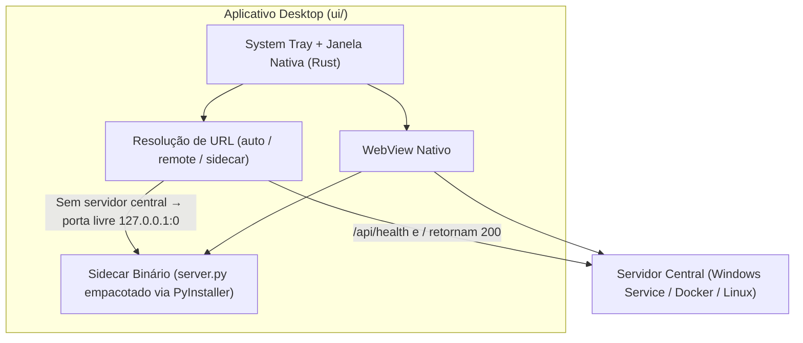

# 🖥️ Aplicativo Desktop Nativo (Tauri) & Modo WTS

O diretório `ui/` contém o shell **Tauri (Rust)** que transforma o **NFSe Manager Pro** em um aplicativo desktop nativo para **Linux (`.deb`, `.AppImage`)**, **Windows (`.msi`, `.exe`)** e **macOS (`.dmg`)**, preparado tanto para uso local quanto para operação simultânea em **Windows Server com Área de Trabalho Remota (WTS)**.

---

## 1. Como Funciona



- **Sem duplicação de frontend**: o WebView nativo carrega exatamente a mesma interface SPA servida pelo backend.
- **System Tray integrado**: ao fechar a janela, o aplicativo pode permanecer na bandeja do sistema com ações rápidas (*"Mostrar Janela"* e *"Encerrar NFSe Manager"*), encerrando o sidecar filho ao sair.
- **Conexão inteligente**: em modo `auto`, o app verifica se já existe um servidor completo respondendo HTTP `200` em `/api/health` e `/` antes de iniciar um sidecar próprio. Na tela de login ou em **Sistema**, também é possível apontar a URL do Servidor Central pela interface.

---

## 2. Operação Multiusuário (Windows Server / WTS)

Em escritórios contábeis usando **Windows Server + Terminal Services (WTS)**, vários colaboradores abrem o aplicativo simultaneamente na mesma máquina. Para evitar conflito de porta (`8000`) e garantir acesso à mesma base:

### Ordem de Descoberta da Configuração
1. Variável de ambiente `NFSE_SERVER_URL` (ex.: `http://127.0.0.1:8000` ou `http://servidor-fiscal:8000`).
2. Arquivo global da máquina:
   - **Windows**: `%PROGRAMDATA%\NFSeManager\desktop.json`
   - **Linux**: `/etc/nfse-manager/desktop.json`
3. Arquivo do usuário:
   - **Windows**: `%APPDATA%\br.com.nfse.manager\desktop.json`
   - **Linux**: `$HOME/.config/nfse-manager/desktop.json`

```json title="Exemplo de desktop.json"
{
  "mode": "auto",
  "server_url": "http://127.0.0.1:8000",
  "data_dir": "D:\\NFSeData",
  "disable_scheduler": false
}
```

### Modos Suportados
- **`auto` (padrão)**: sonda `server_url` (ou `http://127.0.0.1:8000`). Se o serviço central já estiver ativo e servindo a interface web, todas as sessões WTS conectam diretamente a ele **sem** subir outro processo Python. Caso contrário, aloca uma porta TCP livre (`127.0.0.1:0`) e sobe um sidecar isolado para aquela sessão.
- **`central` / `remote`**: conecta diretamente ao `server_url` informado, sem iniciar sidecar local.
- **`sidecar`**: força a execução de um sidecar local em porta TCP livre (`--host 127.0.0.1 --port <PORTA>`).

### Parâmetros CLI do `server.py`
- `--host`: endereço de escuta (padrão `0.0.0.0`).
- `--port`: porta TCP (padrão `8000`; use `0` para alocação automática de porta livre).
- `--data-dir`: define `NFSE_DATA_DIR` (banco SQLite fallback, certificados e downloads).
- `--disable-scheduler`: desabilita o worker interno de contingência neste processo (`NFSE_SCHEDULER_MODE=disabled`).

---

## 3. Pré-requisitos de Desenvolvimento & Build

### Linux (Ubuntu / Debian / Pop!_OS)

```bash
sudo apt-get install -y \
  libwebkit2gtk-4.0-dev \
  librsvg2-dev \
  libssl-dev \
  libgtk-3-dev \
  libayatana-appindicator3-dev \
  patchelf
```

Tenha também **Rust (≥ 1.70)**, **Node.js (≥ 18)** e um **Python 3.12+ com biblioteca compartilhada (`--enable-shared`)** para o empacotamento com PyInstaller.

---

## 4. Modo Desenvolvimento

Na raiz do projeto, execute:

```bash
./run_ui.sh
```

Esse script entra em `ui/` e executa `./dev.sh`, que:

1. Verifica se já existe um servidor completo (`/api/health` e `/`) ativo em `http://127.0.0.1:8000`.
2. Se a porta `8000` estiver livre, inicia `python3 server.py --host 127.0.0.1 --port 8000`; se estiver ocupada (por exemplo, por um container Docker *API-only*), aloca uma porta livre automaticamente e exporta `NFSE_SERVER_URL`.
3. Abre a janela nativa do Tauri apontando para a URL ativa.

---

## 5. Build dos Instaladores (Linux e Windows)

### Linux (`.deb` e `.AppImage`)

```bash
cd ui
./release.sh
```

O script executa:
1. **`./build_sidecar.sh`**: empacota `server.py`, `backend/app`, `frontend/`, `backend/migrations/`, `pyproject.toml` e todas as dependências (incluindo schemas/catálogos do `pynfse`) via PyInstaller para `ui/src-tauri/binaries/server-<target-triple>`.
2. **`npm run tauri build`**: compila o binário Rust e gera os pacotes em `ui/src-tauri/target/release/bundle/deb/` e `appimage/`.

### Windows (`.msi` e `.exe` NSIS)

No Windows (PowerShell), execute:

```powershell
.\ui\release.ps1
```

Isso executa `.\ui\build_sidecar.ps1` (gerando `server-x86_64-pc-windows-msvc.exe`) e `npm run tauri build`, produzindo os instaladores em `ui\src-tauri\target\release\bundle\msi\` e `nsis\`.

> 💡 **Build automático na nuvem**: o workflow [`.github/workflows/desktop-installers.yml`](https://github.com/cleitonleonel/nfse_manager/blob/master/.github/workflows/desktop-installers.yml) compila os instaladores para **Linux** e **Windows** automaticamente via GitHub Actions.
