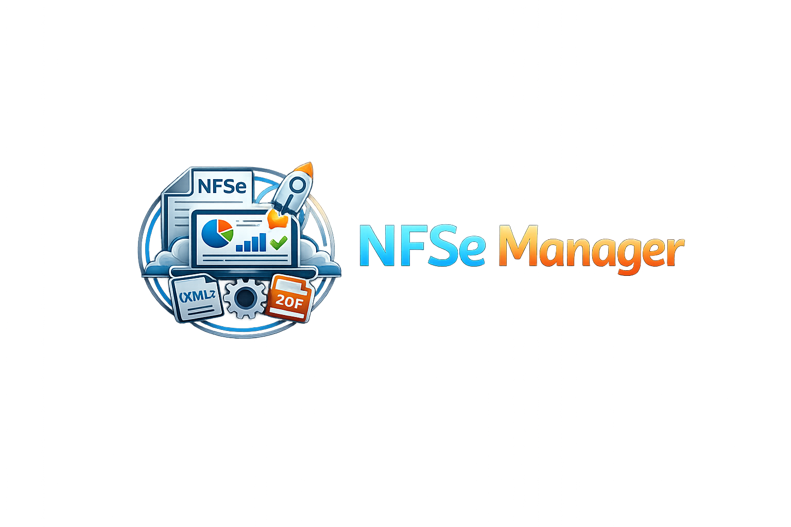
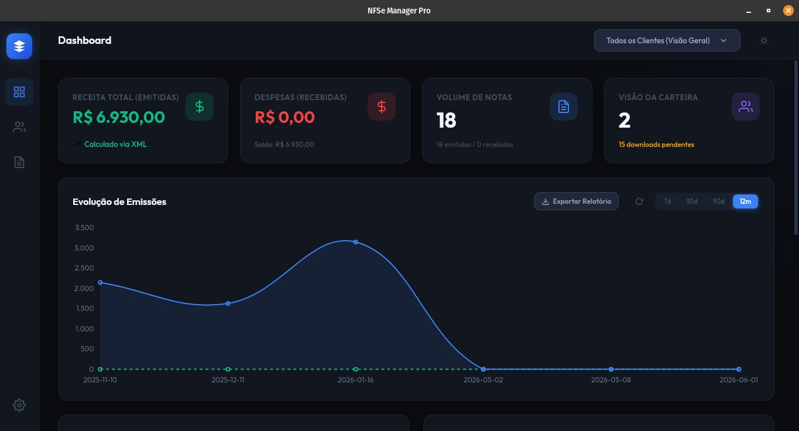
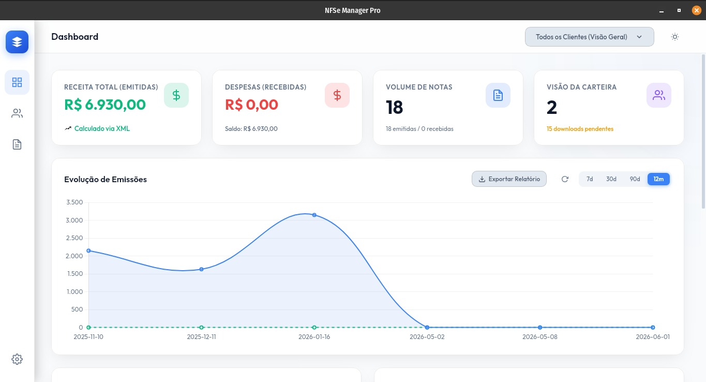

# 🚀 NFSe Manager Pro

<p align="center">
  
</p>

Bem-vindo à documentação oficial do **NFSe Manager Pro** — plataforma completa para **gestão multi-CNPJ, sincronização com o Portal Nacional, cálculo tributário da Reforma Tributária (IBS/CBS e ISSQN) e emissão de NFS-e Nacional (ADN / Sefin Nacional v1.01)**.

---

## 🎯 Visão Geral

O **NFSe Manager Pro** combina:

- **Backend modular em FastAPI (`backend/app/`)**: API REST rápida, assíncrona e documentada via OpenAPI/Swagger.
- **Banco de Dados PostgreSQL (`database/`)**: armazenamento relacional robusto com `SQLAlchemy 2.0`.
- **Motor Fiscal Nacional (`pynfse` / `pynfse.adn`)**:
  - Robô de captura e download no Portal Nacional (`ClienteNfseNacional`) + gerador local de PDF DANFSE (`DanfseGenerator`).
  - Emissão de DPS v1.01, Cancelamento (`e101101`) e Substituição (`e105102`) via mTLS com assinatura digital A1 `XML-DSig` e validação `XSD v1.01`.
  - Catálogos oficiais e calculadora da Reforma Tributária (`LC 214/2025` e `NT 1.101`).
- **Frontend Web SPA (`frontend/`)**: interface responsiva em HTML5/CSS3/JS ES6 com suporte a tema claro/escuro e container Nginx dedicado.
- **Aplicativo Desktop Nativo (`ui/`)**: empacotamento multiplataforma com **Tauri (Rust)**.

---

## 🖼️ Interface da Plataforma




---

## ⚡ Início Rápido com Docker Compose

Suba o banco **PostgreSQL**, o **Backend FastAPI** e o **Frontend Nginx** com um único comando na raiz do projeto:

```bash
docker compose up -d --build
```

| Serviço | URL / Endereço | Descrição |
| :--- | :--- | :--- |
| **Frontend Web (Nginx)** | `http://localhost:3000` | Interface SPA completa |
| **Backend API (FastAPI)** | `http://localhost:8000` | Endpoints `/api/*` e healthcheck `/api/health` |
| **Swagger UI** | `http://localhost:8000/docs` | Documentação interativa OpenAPI |
| **PostgreSQL 16** | `localhost:5434` | Banco `nfse_db` (usuário `nfse_user`) |

---

## 🧭 Navegação da Documentação

- **[Instalação e Execução](instalacao.md)**: como rodar com Docker Compose (unificado ou por serviço), Poetry local e variáveis `.env`.
- **[Visão de Arquitetura](arquitetura.md)**: organização em camadas, estrutura de diretórios e diagramas de sequência.
- **[Banco de Dados (PostgreSQL)](banco-de-dados.md)**: modelagem detalhada das tabelas `clients` e `invoices`.
- **[Reforma Tributária & Emissão ADN v1.01](reforma-tributaria-adn.md)**: regras de cálculo `IBS/CBS` (`2026`, `2027–2032`, `2033+`), catálogos fiscais, assinatura `XML-DSig` e eventos `e101101` / `e105102`.
- **[Referência da API REST](api-referencia.md)**: contratos completos de todos os 9 routers e exemplos práticos `curl`.
- **[Aplicativo Desktop (Tauri)](desktop-tauri.md)**: desenvolvimento e build de instaladores desktop nativos.
- **[Testes, Versionamento e CI/CD](desenvolvimento-ci.md)**: suíte Pytest, Ruff, auto-update transacional e GitHub Actions.
